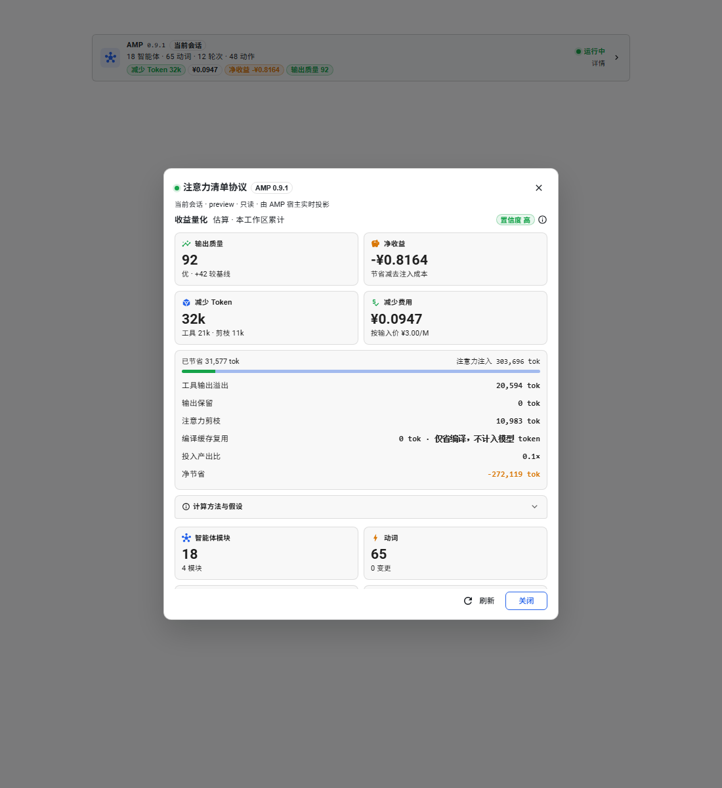

# 收益量化 UI（Value quantification）

本页记录收益量化界面：四个 KPI、按模型/厂商计价、缓存命中率、数据口径和验收证据。

## 目标

在现有 AMP 状态条与详情弹窗上，回答四个问题：

1. 当前插件把输出质量提升了多少？
2. 提升的收益是多少？
3. 节约了多少 Token？
4. 节约了多少花费？

所有数字来自宿主已有计数器与 DSH assistant usage；模型、厂商和缓存命中率都读宿主实际值，不写死单一模型。界面明确标注“估算”，并给出样本量和公式。

## 四个指标

| KPI | 含义 | 口径 |
|---|---|---|
| 输出质量 | 当前上下文保障分，显示为百分比（0–100%） | 新鲜度、预算内、剪枝验证、编译可靠各 25%；50 是“未做保障检查”的中性基线。**不是模型评测。** |
| 净收益 | 节约花费 − 注意力注入费用 | `cost.saved - cost.injected`。负数表示这一次的注意力投入高于省下的 Token，界面不会把它藏起来。 |
| 节约 Token | 毛节省 Token | 溢出字节 ÷ 4 + 保留字节 ÷ 4 + 已验证剪枝 Token。编译缓存复用不计入，因为它省的是序列化工作而非提示词 Token。 |
| 节约花费 | 毛节省费用（CNY 或 USD） | 节省 Token × **有效输入价**。有效输入价 = 缓存命中率 × 缓存命中价 + (1 − 缓存命中率) × 缓存未命中价。 |

补充口径：

- **模型与厂商**：宿主当前选择由 `agent.model.current()` 读取，缺失时回退到 `agentDefaultModel.currentSelection()`；选择的 provider/model 显示在收益量化标题里。
- **不同模型不同价格**：DeepSeek Flash 与 DeepSeek V4-Pro 使用各自的价格表；同一模型再按北京时间高峰/空闲时段取价。高峰为周一至周五 09:00–12:00、14:00–18:00，法定节假日未接入，遇到节假日会按工作日窗口估算。
- **不同厂商不同逻辑**：DeepSeek 官方路由按高峰/空闲、缓存命中/未命中混合；其它路由从静态注册中心取价，有缓存读价时才按命中率混合，没有缓存读价时全部按缓存未命中价，避免把“无缓存折扣”误当成“缓存免费”。订阅/额度计划（全零按量价）明确显示“未配置该模型价格”。
- **注册中心规模**：`41` 个 DSH provider 路由、`1,722` 个去重后的 chat 模型、`1,585` 个有按量 token 价格。来源为 DSH 已安装的 `@earendil-works/pi-ai` 1.3.0 目录（41 路由 / 1,614 模型）加 OpenRouter 2026-11-12 的 `/api/v1/models`（467 模型，补入百度、腾讯、Meta 等较新的条目）。完整列表见 `GET /deepseek-coordination/amp/models`。
- **缓存命中率**：`cacheReadTokens / (inputTokens + cacheReadTokens + cacheWriteTokens)`，来自 `assistant/message` 的 usage。没有 usage 时按 0% 命中率、全部缓存未命中估算，避免高估节省。
- **三种“剪枝/压缩”分开显示**：`注意力剪枝` 是 AMP `ContextPruner` 在轮末验证后删除的注意力条目，计入净节省；`上下文剪枝` 是 DSH `compaction/prune` 把过长的工具结果替换成 head/tail 提示，显示“记录数 × 被替换原文 token”，替换文本仍在上下文里，因此只展示、不重复计入；`上下文压缩` 是 `compaction/summary` 把一段历史替换成摘要，同样只展示“次数 × 原文 token”，摘要本身仍在上下文里，不计入净节省。三者不能合并成一个“剪枝”数字。
- **字节折算**：`4 bytes = 1 token` 保守折算；CJK 文本会被低估，而不是高估。
- **置信度**：由成功编译次数决定：<3 低、<10 中、≥10 高；样本为 0 时不显示质量分。
- **价格快照**：DeepSeek 官方价格页 2026-11（百万 tokens，CNY）：

| 模型 | 时段 | 缓存命中输入 | 缓存未命中输入 | 输出 |
|---|---:|---:|---:|---:|
| deepseek-flash | 空闲 | ¥0.02 | ¥1 | ¥4 |
| deepseek-flash | 高峰 | ¥0.04 | ¥2 | ¥8 |
| deepseek-v4-pro | 空闲 | ¥0.15 | ¥4.5 | ¥13.5 |
| deepseek-v4-pro | 高峰 | ¥0.30 | ¥9 | ¥27 |

## 界面结构（渐进披露）

```
composer strip（一眼）
  节约 Token 20.6k · ¥0.0011 · 净收益 +¥0.0010 · 缓存命中 99% · 输出质量 94%
        ↓ 点击
详情弹窗（解释）
  收益量化标题 + 估算 · deepseek-flash · 高峰价 + 置信度
  2×2 KPI 卡片：输出质量 94% / 净收益 / 节约 Token / 节约花费
  已节省 vs 注意力注入 堆叠条
  分通道账本：溢出 / 保留 / 剪枝 / 缓存复用 / 缓存命中率 / 有效输入价 / 投入产出比 / 净节省
  “计算方法与假设”折叠面板
```

设计依据：

- KPI 卡片不超过四张，放在用户最先扫到的位置；主值最大，辅助说明放在下方，符合 [NHSBSA KPI cards](https://nhsbsa.github.io/nhsbsa-digital-playbook/data/data-visualisation/kpi-cards/) 的布局与格式建议。
- 状态条只给“一眼”信息，详细口径放进弹窗，再用折叠面板披露公式，符合渐进披露；避免在输入区堆叠解释文字。
- 质量分直接显示百分比，和“输出质量”这一表述一致；底层仍是 0–100 的保障分，不伪装成模型评测准确率。
- 所有金额保留 2/4/6 位小数而不是统一 `¥0.00`，避免把小于一分钱的节省显示成零；负号放在货币符号前（`-¥0.8164`）。
- 颜色只做强调，不单独承载语义：净收益同时有文字、正负号和警告色；质量同时有百分比、等级和“代理指标”说明。
- 信息图标可聚焦并带 `aria-label`；状态条按钮的 `aria-label` 包含收益摘要；数值不做 `aria-live`，避免 5 秒轮询反复打断读屏。

## 截图

详情弹窗的四个 KPI、堆叠条、分通道账本和折叠口径：



截图使用合成快照，用于验证布局；早期截图的固定 V4-Pro 价格与“减少”字样已被本轮实现替换，真实数值以运行时的 `/amp/context` 为准。

## 数据通路

`GET /deepseek-coordination/amp/context` 返回 `benefits`：

```ts
interface BenefitSnapshot {
  available: boolean
  model: { provider, model } | null
  pricing: {
    priced, provider, model, name, method, currency, window,
    inputMissPerMillion, inputHitPerMillion, outputPerMillion,
    cacheDiscount, tiers, effectiveInputPerMillion, source
  } | null
  cache: { requests, inputTokens, cacheReadTokens, cacheWriteTokens, outputTokens, totalInputTokens, hitRate }
  registry: { providers, models, priced, sources } | null
  quality: { score, baseline, delta, band, samples, components } | null
  tokens: {
    saved, spill, retention,
    prune, attentionPrune,
    contextPrune, contextPruneRecords,
    compaction, compactionRecords,
    cacheReuse, injected, net, roi, ...
  }
  cost: { saved, injected, net, pricePerMillion, currency, priced }
  confidence: 'none' | 'low' | 'medium' | 'high'
  assumptions: { bytesPerToken, qualityBaseline, qualityWeights, ... }
}
```

宿主新增的计数器：`tokensInjected`（每次编译累计）、`spill.bytes`、`retention.omittedBytes/omittedItems/omittedUnknown`、`prune.shadowedTokens`（DSH 上下文剪枝原文 token）、`compaction.shadowedTokens`（上下文压缩原文 token）。三个纯模块：

- `src/host/pricing.ts`：宿主选择 → 模型价格表；DeepSeek 官方高峰/空闲，其它模型查注册中心，缺失时显式未定价。
- `src/host/registry.ts`：41 个 provider 路由、1,722 个去重模型的查找/别名/统计；`modelRegistry.ts` 和 `openRouterRegistry.ts` 为生成数据。
- `src/host/usage.ts`：按 provider/model 累计 `assistant/message` 的真实 usage，计算缓存命中率。
- `src/host/benefits.ts`：把 Token、质量、价格与命中率组合成快照。
- `GET /deepseek-coordination/amp/models`：只读注册中心列表，支持 `provider`、`q`、`limit` 查询。

## 验收

- `tsc -p tsconfig.json --noEmit`：通过。
- `node --test test/*.test.mjs`：206/206（新增 pricing、注册中心、缓存命中与未定价用例）。
- `tsdown`：host + client 构建通过。
- 真实宿主 `/amp/context`：`model=deepseek-flash`、`window=peak`、缓存命中率 99.35%、有效输入价 ¥0.0527/M、质量 94%。
- 真实宿主 `/amp/models`：`providers=41`、`models=1722`、`priced=1585`；`/amp/models?provider=openai` 返回 GPT-4.1 `$2 / $8 / $0.5`。
- 用 Edge headless 加载真实 `panel.ts` 与 MUI 组件，渲染合成快照并截图；布局、负号、chip 溢出和折叠面板均检查。

## 参考

- [NHSBSA — Key performance indicator (KPI) cards](https://nhsbsa.github.io/nhsbsa-digital-playbook/data/data-visualisation/kpi-cards/)
- [DeepSeek 模型 & 价格（官方）](https://api-docs.deepseek.com/zh-cn/quick_start/pricing/)
